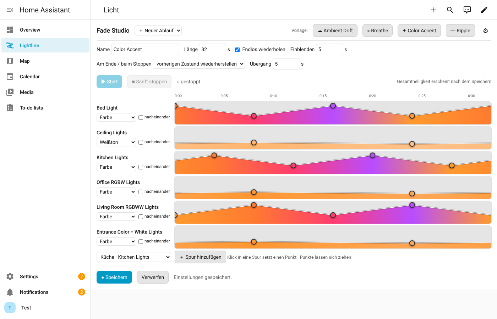

# Fade Studio

Sanfte, animierte Lichtabläufe für Home Assistant – geplant auf einer Zeitleiste mit einer Spur pro Lampe, wie in einem Videoschnittprogramm.



Breit (Tablet quer, Desktop) zeigt die Karte das **Studio** zum Gestalten, schmal (Handy) die **Fernbedienung** zum Starten, Pausieren, Dimmen. Gestaltungsregeln: [docs/DESIGN.md](docs/DESIGN.md).

## Idee

Fade Studio ist **nur ein Editor** (eine Dashboard-Karte). Beim Speichern entstehen ganz normale Home-Assistant-Bausteine:

| Was | Wofür |
|---|---|
| `script.fade_studio_<name>` | spielt den Ablauf ab (die Zeitleiste steckt als `variables` im Skript) |
| `input_number.fade_studio_<name>_dimmer` | Gesamthelligkeit des Ablaufs – alle Lampen im Verhältnis |
| `automation` „Fade Studio: Auto-Stopp“ | stoppt bei Abwesenheit, räumt Schnappschüsse auf, speichert die Einstellungen |
| `scene.fade_studio_<name>_before` | Zustand vor dem Start (nur während ein Ablauf läuft) |
| Label **Fade Studio** | markiert alles, was die Karte erzeugt hat |

Abgespielt wird ausschließlich von Home Assistant selbst. Jeder Abschnitt der Zeitleiste ist **ein** `light.turn_on` mit `transition` – die Lampe (Hue, Zigbee, Matter) überblendet selbst. Das ist weich und belastet das Funknetz kaum.

## Funktionen

- Spuren pro Lampe oder Gruppe, Punkte per Klick setzen und ziehen (Zeit ↔ Helligkeit)
- **Gruppen** (Hue-Räume/-Zonen, Lichtgruppen) erscheinen als eine Spur und lassen sich mit ▸ aufklappen. Jede Lampe der Gruppe kann per Klick eine eigene Spur bekommen (↺ = wieder der Gruppe folgen). Ohne eigene Spuren geht ein einziger Befehl an die Gruppe, synchron und mit wenig Funkverkehr.
- Modi pro Spur: **Weißton** (Kelvin), **Farbe**, **nur Helligkeit** – automatisch passend zur Lampe
- **IKEA-Lampen werden automatisch erkannt** (Hersteller bzw. Modell, auch über Hue Bridge und Matter), mit „IKEA“ markiert und standardmäßig „nacheinander“ überblendet: erst der Ton, dann die Helligkeit
- Endlosschleife (nahtlos), Einblenden, Ende-Verhalten: vorherigen Zustand wiederherstellen, halten, ausblenden, Szene
- Gesamthelligkeit live regelbar – ohne Sprung (Restzeit wird neu berechnet)
- Durchgehender **Abspiel-Strich** mit Zeitanzeige
- **Immer nur ein Ablauf**: Ein Start beendet laufende andere Abläufe und stellt deren Ausgangszustand wieder her
- **Start / Pause / Weiter**: Pause hält die Lampen, wie sie gerade sind; „Weiter“ macht an derselben Stelle der Zeitleiste weiter
- Vorlagen (Auswahlliste „＋ Vorlage …“, alle wiederholen sich spätestens nach 60 s):
  - **☁ Ambient Drift** – ruhiges, zeitversetztes Gleiten zwischen hell/kühler und dunkel/wärmer
  - **🕯 Candle Glow** – sehr warmes Licht, das unregelmäßig und weich auf- und abschwillt, jede Lampe für sich
  - **≈ Breathe** – sanftes Heller und Dunkler, als Welle durch die Räume
  - **🌇 Dusk** – Farblampen ziehen durch Bernstein, Koralle, Rosé, Violett; Ambient- und Weiß-Lampen gedämpft warm
  - **🌌 Aurora** – Farblampen gleiten durch Türkis, Grün, Blau, Violett; Ambient- und Weiß-Lampen schwach kühl
  - **✦ Color Accent** – pro Raum eine Farblampe mit zügigen, kontrastreichen Farbwechseln; die übrigen ruhig warmweiß
  - **⇅ Seesaw** – zwei Hälften wechseln sich ab: eine hell, die andere dunkel
  - **〰 Ripple** – ein heller Impuls wandert der Reihe nach über die Lampen
  - **✧ Twinkle** – mal hier, mal dort leuchtet eine Lampe kurz auf
  - **● Red Dot** – alle Lampen gedämpft warm mit kaum merklichem Flackern; ein satter roter Punkt wandert Raum für Raum über die Farblampen (eine Lampe: 3× Leuchtturm, zwei: 3× Pingpong)
- **Schlafen** (Mond-Taste): Der Ablauf läuft noch die eingestellte Zeit, blendet dann aus und schaltet die Lampen des Ablaufs oder alle Lampen im Haus aus (⚙ Einstellungen)
- **Leuchtenprofile** (⚙ → Leuchten): Was eine Leuchte kann, meldet sie selbst. Je Modell (Hersteller + Modellkennung) lässt sich festlegen: Farben verwenden, Weißtöne verwenden, Ton und Helligkeit nacheinander (Ikea-Modus), Zurückstellen ohne Überblendung. Standards je Hersteller, jederzeit anpassbar. Farben gehen als xy-Werte an die Lampen.
- **Automatisch stoppen** (⚙ Einstellungen):
  - wenn eine Lampe eines laufenden Ablaufs von außen ausgeschaltet wird (Schalter, App, Sprachbefehl, „Alles aus“) – der Ablauf erkennt das selbst. Danach wahlweise alle Lampen des Ablaufs ausschalten (Standard, mit Nachkontrolle nach 2 s) oder nur die ausgeschalteten aus lassen
  - wenn niemand mehr zu Hause ist (`zone.home` wird 0) – danach wahlweise ausschalten, vorherigen Zustand wiederherstellen oder so lassen
- **Alles entfernen** (in den Einstellungen): stoppt laufende Abläufe, stellt den Zustand vor dem Start wieder her und löscht alles, was Fade Studio angelegt hat

## Installation

### HACS (benutzerdefiniertes Repository)
1. HACS → ⋮ → *Benutzerdefinierte Repositories* → URL dieses Repos, Typ **Dashboard**
2. „Fade Studio“ installieren, Browser neu laden

### Manuell
1. `dist/fade-studio-card.js` nach `/config/www/fade-studio-card.js` kopieren
2. Einstellungen → Dashboards → ⋮ → *Ressourcen* → `/local/fade-studio-card.js`, Typ *JavaScript-Modul*

### Karte anlegen
Einstellungen → Dashboards → *Dashboard hinzufügen* („Neues Dashboard von Grund auf“, z. B. „Licht-Abläufe“) → Ansicht bearbeiten → Ansichtstyp **Panel (einzelne Karte)** → Karte hinzufügen → *Manuell*:

```yaml
type: custom:fade-studio-card
```

Speichern erfordert Administratorrechte.

### Einstellungen

Über das Zahnrad ⚙ oben rechts in der Karte: Umgang mit IKEA-Lampen, automatisches Stoppen und „Alles entfernen“.

## Abläufe verwenden

```yaml
# starten (z. B. in einer Automation)
action: script.turn_on
target:
  entity_id: script.fade_studio_ambient_drift

# sanft beenden (mit dem eingestellten Ende-Verhalten)
action: script.turn_on
target:
  entity_id: script.fade_studio_ambient_drift
data:
  variables:
    finish: true

# schlafen: noch 20 min laufen, dann ausblenden und ausschalten
action: script.turn_on
target:
  entity_id: script.fade_studio_ambient_drift
data:
  variables:
    sleep: 20

# Gesamthelligkeit
action: input_number.set_value
target:
  entity_id: input_number.fade_studio_ambient_drift_dimmer
data:
  value: 40
```

`script.turn_off` stoppt hart (ohne Ende-Verhalten).

### Auf anderen Dashboards

Abläufe sind normale Skripte, der Gesamtregler ein normaler `input_number` – dafür reichen die Kacheln von Home Assistant:

```yaml
type: tile
entity: script.fade_studio_red_dot
name: Red Dot
tap_action:            # Antippen: starten
  action: perform-action
  perform_action: script.turn_on
  target: { entity_id: script.fade_studio_red_dot }
hold_action:           # Gedrückt halten: sanft beenden
  action: perform-action
  perform_action: script.turn_on
  target: { entity_id: script.fade_studio_red_dot }
  data: { variables: { finish: true } }
---
type: tile
entity: input_number.fade_studio_red_dot_dimmer
name: Helligkeit
features:
  - type: numeric-input
    style: slider
```

## Entfernen

1. In der Karte ⚙ → **Alles entfernen** – laufende Abläufe stoppen, die Lampen gehen auf den Stand vor dem Start zurück, danach wird alles gelöscht
2. Karte in HACS deinstallieren (bzw. Ressource und Datei löschen), Dashboard löschen

Danach bleibt nichts zurück.

## Grenzen

- Nach einem Neustart von Home Assistant laufen Abläufe nicht automatisch weiter (Automation mit `homeassistant`-Start-Trigger hilft).
- Der Schnappschuss für „vorherigen Zustand wiederherstellen“ überlebt keinen Neustart.
- Sehr kurze Abschnitte (< 2 s) mit vielen Lampen können Hue-Bridge/Zigbee überlasten. Fade Studio ist für ruhige Abläufe gedacht.
- Gespeichert wird über dieselbe Schnittstelle, die der Skript-Editor von Home Assistant nutzt.
